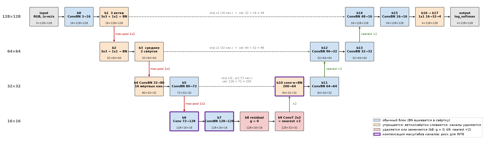
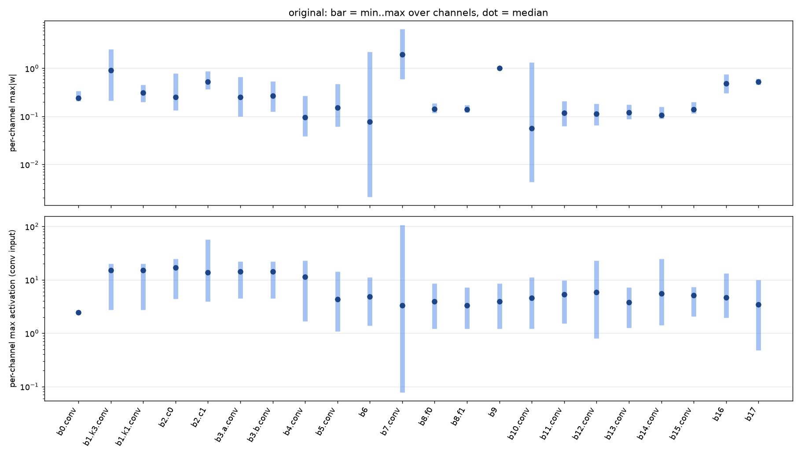
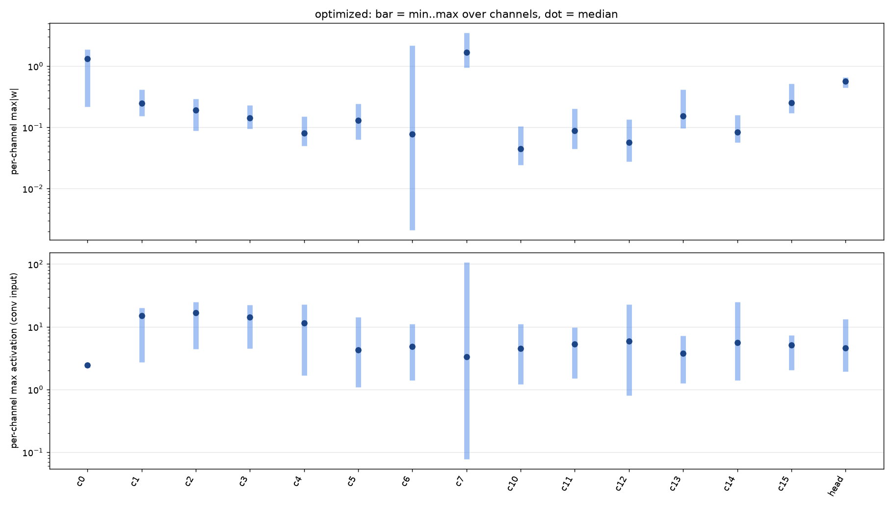
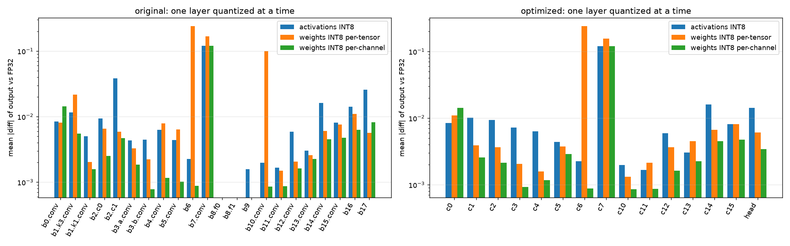

# Анализ, оптимизация и квантование модели сегментации

Окружение для всех замеров: Intel Core i5-12500H (12 ядер, 16 потоков), PyTorch 2.14.1+cpu, Python 3.12.14.
Команды для воспроизведения приведены в `README.md`, код находится в папке `candidate/`.

---

## 1. Структура модели

### 1.1. Восстановление архитектуры

Исходный код модели не предоставлен, поэтому архитектура восстановлена по содержимому TorchScript-архива (`inspect_model.py`):

- `model.code`: порядок операций в `forward`, ветвления и skip-соединения;
- код подмодулей (`model.b1.code` и др.): устройство каждого блока;
- `state_dict`: состав слоёв и их размеры. Вес свёртки имеет форму `[C_out, C_in, k, k]`, вес `ConvTranspose2d` имеет форму `[C_in, C_out, k, k]`; слой BatchNorm определяется по набору тензоров `weight, bias, running_mean, running_var`;
- вызовы `torch.conv2d(..., stride, padding, dilation)` в коде свёрток: шаг и паддинг;
- вспомогательная функция `_p` прочитана из файла `archive/code/__torch__/net.py` внутри архива.

Модель воспроизведена в `model.py` как `torch.nn.Module` с теми же именами модулей и буферов. Благодаря этому веса загружаются вызовом `load_state_dict(ts.state_dict())` без преобразований. Метод `forward` повторяет исходный код операция в операцию.

### 1.2. Схема

Модель представляет собой U-Net с тремя понижениями разрешения (128 → 64 → 32 → 16) и тремя skip-соединениями (s1, s2, s3). Вход нормализуется константами ImageNet.

Оранжевым цветом отмечены блоки, которые упрощаются в разделе 2, красным цветом отмечены удаляемые блоки. Фиолетовая рамка выделяет слои с компенсацией масштабов каналов, проблемные для INT8 (раздел 3).

### 1.3. Таблица слоёв (вход 1×3×128×128)

Учитываются обучаемые параметры: веса, смещения, γ и β слоёв BatchNorm. MACs вычисляются для свёрток по формуле `H_out · W_out · C_out · C_in · k²`, для `ConvTranspose2d` по формуле `H_in · W_in · C_in · C_out · k²`. Операции BatchNorm в MACs не включены.

| Слой | Тип | Вход | Выход | Параметры | MACs |
|---|---|---|---|---:|---:|
| b0.conv | Conv2d | (3, 128, 128) | (16, 128, 128) | 432 | 7 077 888 |
| b0.bn | BatchNorm2d | (16, 128, 128) | (16, 128, 128) | 32 | 0 |
| b1.k3.conv | Conv2d | (16, 128, 128) | (16, 128, 128) | 2 304 | 37 748 736 |
| b1.k3.bn | BatchNorm2d | (16, 128, 128) | (16, 128, 128) | 32 | 0 |
| b1.k1.conv | Conv2d | (16, 128, 128) | (16, 128, 128) | 256 | 4 194 304 |
| b1.k1.bn | BatchNorm2d | (16, 128, 128) | (16, 128, 128) | 32 | 0 |
| b1.bn | BatchNorm2d | (16, 128, 128) | (16, 128, 128) | 32 | 0 |
| b2.c0 | Conv2d | (16, 64, 64) | (32, 64, 64) | 4 608 | 18 874 368 |
| b2.c1 | Conv2d | (32, 64, 64) | (32, 64, 64) | 1 024 | 4 194 304 |
| b2.bn | BatchNorm2d | (32, 64, 64) | (32, 64, 64) | 64 | 0 |
| b3.a.conv | Conv2d | (32, 64, 64) | (32, 64, 64) | 9 216 | 37 748 736 |
| b3.a.bn | BatchNorm2d | (32, 64, 64) | (32, 64, 64) | 64 | 0 |
| b3.b.conv | Conv2d | (32, 64, 64) | (32, 64, 64) | 9 216 | 37 748 736 |
| b3.b.bn | BatchNorm2d | (32, 64, 64) | (32, 64, 64) | 64 | 0 |
| b4.conv | Conv2d | (32, 32, 32) | (80, 32, 32) | 23 040 | 23 592 960 |
| b4.bn | BatchNorm2d | (80, 32, 32) | (80, 32, 32) | 160 | 0 |
| b5.conv | Conv2d | (80, 32, 32) | (72, 32, 32) | 51 840 | 53 084 160 |
| b5.bn | BatchNorm2d | (72, 32, 32) | (72, 32, 32) | 144 | 0 |
| b6 | Conv2d | (72, 16, 16) | (128, 16, 16) | 83 072 | 21 233 664 |
| b7.conv | Conv2d | (128, 16, 16) | (128, 16, 16) | 147 456 | 37 748 736 |
| b7.bn | BatchNorm2d | (128, 16, 16) | (128, 16, 16) | 256 | 0 |
| b8.f0 | Conv2d | (128, 16, 16) | (128, 16, 16) | 147 584 | 37 748 736 |
| b8.f1 | Conv2d | (128, 16, 16) | (128, 16, 16) | 147 584 | 37 748 736 |
| b9 | ConvTranspose2d | (128, 16, 16) | (128, 32, 32) | 65 536 | 16 777 216 |
| b10.conv | Conv2d | (200, 32, 32) | (64, 32, 32) | 115 200 | 117 964 800 |
| b10.bn | BatchNorm2d | (64, 32, 32) | (64, 32, 32) | 128 | 0 |
| b11.conv | Conv2d | (64, 32, 32) | (64, 32, 32) | 36 864 | 37 748 736 |
| b11.bn | BatchNorm2d | (64, 32, 32) | (64, 32, 32) | 128 | 0 |
| b12.conv | Conv2d | (96, 64, 64) | (32, 64, 64) | 27 648 | 113 246 208 |
| b12.bn | BatchNorm2d | (32, 64, 64) | (32, 64, 64) | 64 | 0 |
| b13.conv | Conv2d | (32, 64, 64) | (32, 64, 64) | 9 216 | 37 748 736 |
| b13.bn | BatchNorm2d | (32, 64, 64) | (32, 64, 64) | 64 | 0 |
| b14.conv | Conv2d | (48, 128, 128) | (16, 128, 128) | 6 912 | 113 246 208 |
| b14.bn | BatchNorm2d | (16, 128, 128) | (16, 128, 128) | 32 | 0 |
| b15.conv | Conv2d | (16, 128, 128) | (16, 128, 128) | 2 304 | 37 748 736 |
| b15.bn | BatchNorm2d | (16, 128, 128) | (16, 128, 128) | 32 | 0 |
| b16 | Conv2d | (16, 128, 128) | (32, 128, 128) | 544 | 8 388 608 |
| b17 | Conv2d | (32, 128, 128) | (4, 128, 128) | 132 | 2 097 152 |
| **Итого** | | | | **893 316** | **843 710 464** |

Кроме слоёв из таблицы, модель содержит буферы `m`, `s` (нормализация входа), `pi` (перестановка каналов), `b8.g` и `b10.alpha` (поканальные множители), а также операции без параметров: ReLU в пяти различных записях, max-pool, nearest upsampling, конкатенацию и `log(softmax)`.

### 1.4. Проверка воспроизведения (`model.py`, `analyze.py`)

| Проверка | Результат |
|---|---|
| max\|diff\| Net и model.pt (случайный вход и 8 изображений) | 0,0 |
| совпадение argmax | 100% |
| число параметров | 893 316 |
| mIoU на 8 изображениях | 0,9387 |

Разница равна нулю точно, поскольку Net выполняет те же операции в том же порядке и совпадают даже ошибки округления.

---

## 2. Оптимизация без изменения результата

### 2.1. Поиск упрощаемых мест

Поиск выполнялся по трём признакам (`inspect_model.py`):

1. **Нестандартные буферы**, которые не создаёт ни один стандартный слой PyTorch: `m`, `s`, `pi`, `b8.g`, `b10.alpha`.
2. **Нестандартные конструкции в коде forward**: пять различных записей ReLU, `index_select`, последовательные свёртки без нелинейности, параллельные ветви с суммированием.
3. **Аномалии в весах**, проверенные одинаково для всех тензоров: число нулей, число уникальных значений, нулевые выходные каналы, разброс масштаба каналов (отношение наибольшего по каналам значения max|w| к наименьшему). Обученные веса не содержат точных нулей и повторов, поэтому такие признаки указывают на ручное вмешательство.

Аномалии, выявленные аудитом весов:

| Тензор | Аномалия |
|---|---|
| b4.conv.weight | 16 нулевых фильтров из 80 |
| b6.weight | разброс масштаба каналов 1029× |
| b8.g | все 128 значений равны 0 |
| b9.weight | 2 уникальных значения (0 и 1), 65 024 нуля из 65 536 |
| b10.conv.weight | разброс масштаба каналов 308× |

У остальных свёрток разброс составляет от 1,3× до 12×, нулевые фильтры отсутствуют, |γ| всех слоёв BatchNorm превышает 1e-3.

### 2.2. Найденные упрощения

Обозначения: BatchNorm в режиме eval является поканальным аффинным преобразованием `y = k · x + t`, где `k = γ / √(σ² + ε)`, `t = β − k · μ`.

| № | Блок | Конструкция | Обоснование эквивалентности |
|---|---|---|---|
| 1 | все ConvBN | Conv → BN | `W' = k · W`, `b' = k · b + t` по выходным каналам |
| 2 | b1 | 3x3-BN + 1x1-BN + BN(x) | сумма линейных операций; свёртка 1x1 эквивалентна свёртке 3x3 с ненулевым центром, BN(x) эквивалентен свёртке 3x3 с ядром `k_c` в центре канала c (приём RepVGG) |
| 3 | b2 | conv3x3 → conv1x1 → BN без нелинейности | свёртка 1x1 есть умножение на матрицу в каждой точке: `W = C₁ · W₀`; паддинг не нарушает равенства, так как свёртка 1x1 поточечна |
| 4 | b3 | (a(x) + b(x)) / 2 | линейность свёртки: `W = (W_a + W_b) / 2`, `b = (b_a + b_b) / 2` |
| 5 | b4 → b5 | 16 мёртвых каналов | фильтр нулевой, поэтому после BN канал равен константе `t_c`; `max t_c = −0,355 ≤ 0`, поэтому после ReLU канал тождественно равен 0; каналы удаляются из выхода b4 и входа b5 |
| 6 | b8 | Dropout2d(x + g · r) | `g = 0` во всех каналах, поэтому `x + 0 · r = x`; Dropout в режиме eval является тождественным |
| 7 | b9 | ConvTranspose 2x2, stride 2 | ядро постоянно по позициям 2x2 и по каналам равно единичной матрице, поэтому каждый пиксель копируется в блок 2x2, что совпадает с nearest upsampling ×2 |
| 8 | b10 | cat[·, s3[:, pi]] | pi является перестановкой (72 уникальных значения из 72), поэтому она переносится в порядок входных каналов весов: `W'[:, 128 + pi[j]] = W[:, 128 + j]` |
| 9 | b10 | BN(conv(x) · alpha) | alpha является множителем выходного канала и вносится в фильтры: `W' = alpha · W`; знак множителя не нарушает равенства |
| 10 | b16 → b17 | две свёртки 1x1 без нелинейности | `W = W₁₇ · W₁₆`, `b = W₁₇ · b₁₆ + b₁₇` |
| 11 | все блоки | `(x + abs(x)) / 2`, `leaky_relu(·, 0)`, `where(x > 0, x, 0)`, `maximum(x, 0)`, `clamp(min=0)` | все выражения равны `max(x, 0)`, то есть ReLU |
| 12 | после s1 | reshape + amax | max-pool 2x2 |
| 13 | выход | log(softmax(x)) | математически равно log_softmax, но численно менее устойчиво (п. 2.6) |

Эффект по блокам (по таблицам `analyze.py` для Net и NetOpt):

| Блок | Параметры | MACs |
|---|---|---|
| b1 | 2 656 → 2 320 | −4,2 млн |
| b2 | 5 696 → 4 640 | −4,2 млн |
| b3 | 18 560 → 9 248 | −37,7 млн |
| b4 + b5 | 75 184 → 60 040 | −15,3 млн |
| b8 | −295 168 | −75,5 млн |
| b9 | −65 536 | −16,8 млн |
| b16 + b17 | 676 → 68 | −9,4 млн |
| BN во всех блоках | γ и β переходят в смещения свёрток | −16 поэлементных операций |
| b10: alpha, pi | без изменений | −2 операции (умножение, выборка каналов) |

### 2.3. Проверка по блокам (`optimize.py`, случайный вход)

| Блок | max\|diff\| |
|---|---:|
| b0 | 4,77e-6 |
| b1 | 3,81e-6 |
| b2 | 2,86e-6 |
| b3 | 4,05e-6 |
| b4 + b5 (удаление каналов) | 9,54e-6 |
| b5 | 1,14e-5 |
| b7 | 6,29e-5 |
| b9 | 0 |
| b10 | 6,91e-6 |
| b11 … b15 | от 4,05e-6 до 6,20e-6 |
| b16 + b17 | 1,43e-6 |

Наблюдаемые отличия соответствуют погрешности float32 (около 7 значащих цифр): объединённая свёртка выполняет те же вычисления в ином порядке. Абсолютная ошибка b7 больше из-за больших значений на выходе слоя (веса b7 достигают 6,5 вследствие компенсации масштаба b6 → b7, п. 2.7), при этом относительная ошибка остаётся порядка 1e-7. Для b9 разница равна нулю, поскольку обе операции только копируют значения. Значения мёртвых каналов b4 после ReLU на случайном входе равны нулю точно.

### 2.4. Итоговое сравнение

| | Net (исходная) | NetOpt | Изменение |
|---|---:|---:|---:|
| Параметры | 893 316 | 505 788 | −43,4% |
| MACs | 843,7 млн | 680,5 млн | −19,3% |
| max\|diff\| относительно model.pt, изображения | 0 | 3,3e-5 | |
| max\|diff\| относительно model.pt, случайный вход | 0 | 1,5e-5 | |
| совпадение argmax | 100% | 100% | |
| mIoU, 8 изображений | 0,9387 | 0,9387 | |

Таблица слоёв NetOpt:

| Слой | Вход | Выход | Параметры | MACs |
|---|---|---|---:|---:|
| c0 | (3, 128, 128) | (16, 128, 128) | 448 | 7 077 888 |
| c1 | (16, 128, 128) | (16, 128, 128) | 2 320 | 37 748 736 |
| c2 | (16, 64, 64) | (32, 64, 64) | 4 640 | 18 874 368 |
| c3 | (32, 64, 64) | (32, 64, 64) | 9 248 | 37 748 736 |
| c4 | (32, 32, 32) | (64, 32, 32) | 18 496 | 18 874 368 |
| c5 | (64, 32, 32) | (72, 32, 32) | 41 544 | 42 467 328 |
| c6 | (72, 16, 16) | (128, 16, 16) | 83 072 | 21 233 664 |
| c7 | (128, 16, 16) | (128, 16, 16) | 147 584 | 37 748 736 |
| c10 | (200, 32, 32) | (64, 32, 32) | 115 264 | 117 964 800 |
| c11 | (64, 32, 32) | (64, 32, 32) | 36 928 | 37 748 736 |
| c12 | (96, 64, 64) | (32, 64, 64) | 27 680 | 113 246 208 |
| c13 | (32, 64, 64) | (32, 64, 64) | 9 248 | 37 748 736 |
| c14 | (48, 128, 128) | (16, 128, 128) | 6 928 | 113 246 208 |
| c15 | (16, 128, 128) | (16, 128, 128) | 2 320 | 37 748 736 |
| head | (16, 128, 128) | (4, 128, 128) | 68 | 1 048 576 |
| **Итого** | | | **505 788** | **680 525 824** |

### 2.5. Время инференса на CPU (`benchmark.py`)

Конфигурация: Intel Core i5-12500H, PyTorch 2.14.1+cpu. Для каждого режима измеряется медиана 100 прогонов после 10 прогревочных. Скрипт запускался три раза; в таблице приведена медиана по трём запускам, так как отдельные запуски содержат выбросы (например, Net, batch 1, 12 потоков: 10,29 мс в одном запуске против 8,1 и 8,2 мс в остальных).

| Режим | model.pt, мс | Net, мс | NetOpt, мс | Ускорение NetOpt |
|---|---:|---:|---:|---:|
| batch 1, 1 поток | 20,45 | 20,70 | 16,46 | ×1,24 |
| batch 1, 12 потоков | 8,08 | 8,22 | 5,80 | ×1,39 |
| batch 8, 1 поток | 174,93 | 177,05 | 141,83 | ×1,23 |
| batch 8, 12 потоков | 62,81 | 63,93 | 44,70 | ×1,41 |

В отдельных запусках ускорение NetOpt составляет от ×1,22 до ×1,50.

Выводы:

- Время Net и model.pt совпадает с точностью до 2%, следовательно, ускорение NetOpt обусловлено упрощениями, а не способом запуска.
- В однопоточном режиме ускорение (×1,23 и ×1,24) соответствует сокращению MACs (×1,24). В многопоточном режиме ускорение выше (×1,39 и ×1,41): помимо умножений в свёртках удалены 16 слоёв BatchNorm, параллельные ветви, `index_select` и поэлементные операции. Каждая такая операция читает и записывает тензор целиком и требует синхронизации потоков, поэтому их удаление сильнее сказывается при параллельном выполнении.
- Переход с 1 на 12 потоков ускоряет модель в 2,5…3,2 раза. На входе 128×128 объём работы многих слоёв недостаточен для полной загрузки всех ядер, кроме того, часть ядер процессора энергоэффективные. На встраиваемом вычислителе с небольшим числом ядер выигрыш от упрощений следует ожидать ближе к однопоточному значению.

### 2.6. Приближённые упрощения (`approx.py`)

**Замена log(softmax) на log_softmax.** Выражения равны математически, однако при уверенном предсказании softmax даёт вероятности меньше наименьшего представимого числа float32, они округляются до 0, и `log(0) = −∞`. Функция log_softmax вычисляется как `z − max(z) − log Σ exp(z − max(z))` и остаётся конечной.

| Масштаб логитов k | −inf в log(softmax) | max\|diff\| на конечных значениях | min log_softmax |
|---:|---:|---:|---:|
| 1 (исходная модель) | 0 из 524 288 | 9,5e-7 | −12,8 |
| 5 | 0 | 3,8e-6 | −63,9 |
| 10 | 520 | 0,68 | −127,7 |
| 20 | 384 161 | 0,69 | −255,5 |
| 50 | 392 458 | 0,41 | −638,7 |

Для текущей модели замена эквивалентна (разница порядка 1e-6). Для более уверенной модели log(softmax) теряет точность и возвращает −∞. Если на устройстве требуется только класс пикселя, softmax можно не вычислять.

**Внесение нормализации (x − m)/s в первую свёртку.** Используется равенство `conv((x − m)/s) = conv'(x)`, где `W'[o, i] = W[o, i] / s[i]`, `b' = b − Σ W[o, i] · m[i] / s[i]`. Внутри кадра равенство выполняется точно, на границе нет: исходная свёртка дополняет нулями уже нормализованный вход, что соответствует исходному пикселю со значением m, а после внесения нормализации нулевой паддинг соответствует исходному пикселю со значением 0.

| Место измерения | max\|diff\| |
|---|---:|
| выход первой свёртки, рамка 1 пиксель | 12,5 |
| выход первой свёртки, внутренняя область | 8,7e-6 |
| выход сети, рамка 1 пиксель | 2,34 |
| выход сети, вне рамки 4 пикселя | 5,06 |
| выход сети, вне рамки 16 пикселей | 2,87 |
| совпадение argmax | 99,955% |

Ошибка возникает только на крайних пикселях выхода первой свёртки, но распространяется почти на весь кадр: после трёх понижений разрешения рецептивное поле нейронов нижнего уровня охватывает почти всё изображение, а декодер переносит ошибку обратно на полное разрешение.

После такого преобразования mIoU составил 0,9517 против 0,9387. Это не улучшение, а следствие малой выборки: изменилось 0,045% пикселей, при этом класс «прямоугольник» присутствует только на одном изображении из восьми, и изменение нескольких пикселей заметно сдвигает его IoU. Цель упрощений состоит в сохранении выхода модели.

**Точный вариант:** дополнять исходное изображение значением m и выполнять свёртку без паддинга. В этом случае разница на выходе первой свёртки составляет 8,7e-6. В NetOpt нормализация сохранена отдельной операцией.

### 2.7. Наблюдение, существенное для квантования

Модель содержит компенсацию масштабов между слоями, которая не изменяет результат в FP32:

- **b6 → b7.** Каналы выхода b6 растянуты с разбросом 1029×, входные веса b7 уменьшены в обратной пропорции (коэффициент корреляции логарифмов масштабов −0,98). Эквивалентность следует из `ReLU(c · z) = c · ReLU(z)` при `c > 0`.
- **b10.** Разброс масштаба каналов свёртки 308× компенсируется множителем alpha (по модулю от 0,1 до 8,6).

При квантовании активаций с одним масштабом на тензор слабые каналы округляются до нуля. Во втором случае проблему устраняет внесение alpha в веса (п. 2.2), в первом требуется выравнивание масштабов между слоями (раздел 3).

---

## 3. Квантование

### 3.1. Схема квантования (`quantize.py`)

Применяется собственная симуляция (fake-quant): значения округляются до сетки INT8 или INT16, вычисления выполняются во float. Такой подход позволяет квантовать слои по отдельности и оценивать вклад каждого.

Точки квантования: веса и входная активация каждого слоя `Conv2d` и `ConvTranspose2d` (22 слоя в исходной модели, 15 в оптимизированной).

- **Веса**: симметричное квантование `q = clamp(round(w / scale), −Q, Q)`, где `Q = 2^(b−1) − 1` (127 для INT8, 32 767 для INT16), `scale = max|w| / Q`. Рассматриваются варианты с одним масштабом на тензор (per-tensor) и на выходной канал (per-channel).
- **Активации**: асимметричное квантование с одним масштабом на тензор. Диапазон `[lo, hi]`, полученный при калибровке и расширенный до включения нуля, отображается в `0 … 2^b − 1`: `scale = (hi − lo) / (2^b − 1)`, `zero_point = round(−lo / scale)`.
- Смещения, BatchNorm исходной модели и выходной log_softmax остаются во float, что соответствует int32-аккумулятору и выходному слою во float на устройстве.

### 3.2. Калибровочные данные

Калибровка выполняется на 32 случайно сгенерированных изображениях 128×128. Рассмотрены три распределения:

- **uniform**: каждый пиксель из U[0, 1];
- **gauss**: N(0,45; 0,25) с ограничением диапазоном [0, 1];
- **shapes**: синтетические сцены, состоящие из плавного цветного фона (случайная сетка от 3×3 до 8×8, увеличенная бикубической интерполяцией), от 1 до 4 залитых случайным цветом кругов, прямоугольников или треугольников случайного размера и поворота и шума с σ = 0,02.

Выбрано распределение **shapes**. Диапазоны активаций определяются содержимым изображения. Шум не содержит однородных областей, границ и объектов, поэтому глубокие слои, реагирующие на фигуры, на нём почти не активируются. Синтетические сцены воспроизводят статистику целевых данных (однородные области, резкие границы, фигуры), но генерируются случайно и не используют приложенные изображения.

Максимум входа свёртки (оптимизированная модель):

| Слой | uniform | gauss | shapes | реальные изображения |
|---|---:|---:|---:|---:|
| c1 | 22,65 | 19,13 | 20,21 | 14,91 |
| c4 | 10,81 | 8,73 | 22,90 | 15,67 |
| c5 | 4,61 | 3,90 | 14,22 | 9,67 |
| c6 | 2,87 | 2,72 | 11,17 | 8,06 |
| c7 | 32,69 | 32,53 | 107,16 | 135,69 |
| c10 | 2,87 | 2,72 | 11,17 | 9,87 |
| c11 | 2,38 | 2,68 | 9,79 | 9,82 |
| head | 6,38 | 6,00 | 13,13 | 12,96 |

При калибровке на шуме диапазоны глубоких слоёв занижены в 3…4 раза, и на реальных изображениях значения обрезаются. По этой причине даже INT16 при такой калибровке теряет точность:

| Калибровка | Модель | INT16: argmax / mIoU | INT8: argmax / mIoU |
|---|---|---|---|
| uniform | исходная | 99,31% / 0,792 | 99,63% / 0,795 |
| uniform | оптимизированная | 99,42% / 0,809 | 99,64% / 0,804 |
| gauss | исходная | 99,49% / 0,817 | 99,67% / 0,805 |
| gauss | оптимизированная | 99,64% / 0,842 | 99,67% / 0,805 |
| **shapes** | исходная | **99,9992% / 0,939** | 99,73% / 0,837 |
| **shapes** | оптимизированная | **99,9992% / 0,939** | 99,78% / 0,857 |

Веса квантуются per-channel.

### 3.3. Сравнение FP32, INT16 и INT8

Калибровка shapes; метрики вычислены на 8 приложенных изображениях относительно FP32-выхода той же модели.

| Модель | Точность | max\|d\| | mean\|d\| | cos | argmax | mIoU |
|---|---|---:|---:|---:|---:|---:|
| исходная | FP32 | 0 | 0 | 1 | 100% | 0,9387 |
| исходная | INT16, веса per-tensor | 0,204 | 0,0019 | 1,00000 | 99,9992% | 0,9383 |
| исходная | INT16, веса per-channel | 0,195 | 0,0011 | 1,00000 | 99,9992% | 0,9390 |
| исходная | INT8, веса per-tensor | 6,945 | 0,3327 | 0,99427 | 98,66% | 0,6953 |
| исходная | INT8, веса per-channel | 4,531 | 0,2001 | 0,99846 | 99,73% | 0,8365 |
| оптимизированная | FP32 | 0 | 0 | 1 | 100% | 0,9387 |
| оптимизированная | INT16, веса per-tensor | 0,196 | 0,0012 | 1,00000 | 100% | 0,9387 |
| оптимизированная | INT16, веса per-channel | 0,195 | 0,0010 | 1,00000 | 99,9992% | 0,9390 |
| оптимизированная | INT8, веса per-tensor | 6,249 | 0,2708 | 0,99585 | 98,82% | 0,7096 |
| оптимизированная | INT8, веса per-channel | 4,559 | 0,1885 | 0,99860 | 99,78% | 0,8569 |

- **INT16** практически не вносит потерь: совпадение argmax 99,9992% соответствует одному пикселю из 131 072. Остаточная ошибка max\|d\| ≈ 0,2 вызвана не разрешением INT16, а обрезкой: на входе c7 значения реальных изображений достигают 135,7 при калиброванном максимуме 107,2.
- **INT8** без дополнительных мер заметно ухудшает результат, особенно при квантовании весов per-tensor.

Метрика mIoU на 8 изображениях чувствительна к случайным отклонениям: класс «прямоугольник» присутствует только на одном изображении, и изменение нескольких пикселей заметно сдвигает его IoU. Поэтому основные выводы сделаны по mean\|d\|, косинусной близости и доле совпадающих argmax; mIoU приводится как дополнительная метрика.

### 3.4. Распределения весов и активаций по слоям

Для каждого слоя показан разброс по каналам максимума |w| (верхний график) и максимума входной активации (нижний график). Полоса соответствует диапазону от минимального до максимального канала, точка соответствует медиане.

Наблюдения:

| Слой | Наблюдение |
|---|---|
| вход b7 / c7 | максимумы каналов от ≈0,08 до ≈107 (разброс около 1300×); у остальных слоёв разброс не превышает 30× |
| веса b6 / c6 | максимумы каналов от 0,002 до 2,2 (1029×) |
| веса b10 (исходная модель) | от 0,004 до 1,3 (308×); у c10 после внесения alpha в веса от 0,025 до 0,1 |
| вход b2.c1 (исходная модель) | промежуточный тензор между свёртками, принимает значения обоих знаков в широком диапазоне (−48 … 57) |
| вход b17 (исходная модель) | промежуточный тензор выходного блока, значения обоих знаков (−7 … 10) |
| веса b9 (исходная модель) | все значения каналов равны 1, квантование выполняется без ошибки |
| веса после внесения BN | у c0 разброс каналов увеличился (b0.conv ≈1,6×, c0 ≈8×), так как BN масштабирует каналы с разными коэффициентами; у c1 разброс меньше, чем у ветви b1.k3. Внесение BN может как ухудшать, так и улучшать условия для квантования per-tensor |

### 3.5. Послойная чувствительность

В INT8 квантуется один слой, остальные остаются в FP32. Отдельно измеряется вклад активаций (вход слоя) и весов (per-tensor и per-channel); метрика: mean\|d\| выхода относительно FP32.

| Слой (исходная / оптимизированная) | Активации INT8 | Веса per-tensor | Веса per-channel |
|---|---:|---:|---:|
| b0 / c0 | 0,0084 / 0,0084 | 0,0081 / 0,0110 | 0,0143 / 0,0143 |
| b1 (k3, k1) / c1 | 0,0116, 0,0050 / 0,0101 | 0,0216, 0,0020 / 0,0039 | 0,0055, 0,0016 / 0,0026 |
| b2 (c0, c1) / c2 | 0,0094, **0,0381** / 0,0094 | 0,0065, 0,0059 / 0,0036 | 0,0025, 0,0047 / 0,0022 |
| b3 (a, b) / c3 | 0,0043, 0,0044 / 0,0072 | 0,0033, 0,0022 / 0,0021 | 0,0019, 0,0008 / 0,0009 |
| b4 / c4 | 0,0063 / 0,0063 | 0,0079 / 0,0016 | 0,0012 / 0,0012 |
| b5 / c5 | 0,0044 / 0,0044 | 0,0064 / 0,0038 | 0,0010 / 0,0029 |
| **b6 / c6** | 0,0023 / 0,0023 | **0,2411 / 0,2411** | 0,0009 / 0,0009 |
| **b7 / c7** | **0,1201 / 0,1201** | **0,1689 / 0,1557** | **0,1200 / 0,1200** |
| b8.f0, b8.f1 / нет | 0 | 0 | 0 |
| b9 / нет | 0,0016 | 0 | 0 |
| **b10** / c10 | 0,0020 / 0,0020 | **0,0999** / 0,0013 | 0,0009 / 0,0009 |
| b11 / c11 | 0,0017 / 0,0017 | 0,0015 / 0,0021 | 0,0009 / 0,0009 |
| b12 / c12 | 0,0059 / 0,0059 | 0,0020 / 0,0036 | 0,0016 / 0,0016 |
| b13 / c13 | 0,0030 / 0,0030 | 0,0026 / 0,0045 | 0,0022 / 0,0022 |
| b14 / c14 | 0,0161 / 0,0161 | 0,0060 / 0,0067 | 0,0045 / 0,0045 |
| b15 / c15 | 0,0081 / 0,0081 | 0,0075 / 0,0081 | 0,0047 / 0,0047 |
| b16, b17 / head | 0,0142, **0,0258** / 0,0142 | 0,0109, 0,0057 / 0,0061 | 0,0063, 0,0082 / 0,0034 |

Для b7 / c7 ошибка при квантовании весов per-channel (0,12) совпадает с ошибкой квантования активаций: при квантовании весов вход слоя по-прежнему растянут, и основной вклад вносит именно он. Для b8 ошибка равна нулю, поскольку выход блока умножается на g = 0. Для c0 квантование per-channel даёт несколько бо́льшую ошибку, чем per-tensor (0,0143 против 0,0110): фильтр первого слоя содержит всего 27 весов, и результат округления в значительной мере случаен; обе ошибки малы.

### 3.6. Проблемные слои: причины и способы устранения

| Слой | Проявление | Причина | Способ устранения |
|---|---|---|---|
| вход b7 / c7 | основной источник ошибки INT8 | каналы выхода b6 растянуты, веса b7 уменьшены в обратной пропорции (компенсация масштабов); общий масштаб тензора определяется каналами с максимумом ≈107, и слабые каналы округляются до 0 (шаг ≈0,42) | выравнивание масштабов между слоями (CLE) или INT16 для этого входа |
| веса b6 / c6 | ошибка при per-tensor | та же компенсация: разброс каналов весов 1029× | квантование per-channel или CLE |
| веса b10 (исходная модель) | ошибка при per-tensor | веса компенсируют множитель alpha (разброс 308×) | внесение alpha в веса (раздел 2) или квантование per-channel |
| вход b2.c1, b17 (исходная модель) | широкий диапазон значений обоих знаков | промежуточные тензоры между свёртками без нелинейности | объединение свёрток (раздел 2) или INT16 для этих входов |
| вход c7 (обе модели) | обрезка даже в INT16 | калибровка не охватывает максимум реальных данных | увеличение калибровочной выборки или запас диапазона |

**Выравнивание масштабов (CLE, Nagel et al., 2019).** Для пары `conv_a → ReLU → conv_b` и канала k вычисляется `s_k = √(r_a[k] / r_b[k])`, где `r_a[k]` есть max\|w\| выходного канала k слоя conv_a, `r_b[k]` есть max\|w\| входного канала k слоя conv_b. Затем выполняется `W_a[k] /= s_k`, `b_a[k] /= s_k`, `W_b[:, k] *= s_k`. В FP32 результат не изменяется, так как `ReLU(z / s) = ReLU(z) / s` при `s > 0` (проверено: max\|d\| = 1,3e-5), а масштабы каналов выравниваются.

Результаты (INT8, калибровка shapes):

| Модель | Вариант | max\|d\| | mean\|d\| | cos | argmax | mIoU |
|---|---|---:|---:|---:|---:|---:|
| исходная | без исправлений (веса per-channel) | 4,531 | 0,2001 | 0,99846 | 99,73% | 0,8365 |
| исходная | калибровка по перцентилю 99,99% | 4,160 | 0,1690 | 0,99885 | 99,76% | 0,8407 |
| исходная | вход b7 в INT16 | 2,511 | 0,0635 | 0,99982 | 99,95% | 0,9184 |
| исходная | CLE b6 → b7 | 2,556 | 0,0633 | 0,99982 | 99,94% | 0,9163 |
| исходная | CLE, веса per-tensor | 3,399 | 0,1166 | 0,99941 | 99,84% | 0,9328 |
| оптимизированная | без исправлений (веса per-channel) | 4,559 | 0,1885 | 0,99860 | 99,78% | 0,8569 |
| оптимизированная | калибровка по перцентилю 99,99% | 4,155 | 0,1621 | 0,99889 | 99,76% | 0,8418 |
| оптимизированная | вход c7 в INT16 | 1,358 | 0,0387 | 0,99993 | 99,993% | 0,9372 |
| **оптимизированная** | **CLE c6 → c7** | 1,402 | **0,0385** | **0,99993** | **99,994%** | **0,9375** |
| оптимизированная | CLE, веса per-tensor | 1,312 | 0,0385 | 0,99994 | 99,994% | 0,9376 |

Выводы:

- **Калибровка по перцентилю почти не снижает ошибку**: причина не в редких выбросах, а в различии масштабов каналов одного тензора на три порядка.
- **CLE устраняет основную проблему**: ошибка INT8 уменьшается в 3…5 раз без изменения результата в FP32 и без дополнительных вычислений при инференсе. Сопоставимый эффект даёт INT16 для входа c7, однако этот вариант требует поддержки смешанной точности на устройстве.
- **После CLE оптимизированная модель квантуется лучше исходной** (mean\|d\| 0,039 против 0,063, argmax 99,994% против 99,94%). В исходной модели сохраняются промежуточные тензоры b2.c1 и b17 и веса b10 с компенсацией alpha. Различие особенно заметно при квантовании весов per-tensor: 99,994% против 99,84%. Следовательно, упрощения из раздела 2 не только ускоряют модель, но и улучшают её пригодность для INT8.
- Оптимизированная модель после CLE одинаково работает с весами per-tensor и per-channel и поэтому применима на вычислителях, поддерживающих только квантование per-tensor.

### 3.7. Ограничения

- Симуляция fake-quant воспроизводит округление, но не целочисленные вычислительные ядра: смещения, BatchNorm исходной модели и log_softmax вычисляются во float, переквантование выхода свёртки до входа следующего слоя отдельно не моделируется. Точность на устройстве требуется подтвердить средствами целевого вычислителя.
- Оценка выполнена на 8 изображениях; mIoU на такой выборке подвержен случайным отклонениям, поэтому выводы основаны на mean\|d\|, косинусной близости и argmax.

---

## 4. Выводы и рекомендации

### 4.1. Выводы

1. Модель является U-Net с 893 тыс. параметров и 844 млн MACs, в которую намеренно добавлены избыточные и маскирующие конструкции: неработающий остаточный блок, транспонированная свёртка вместо nearest upsampling, мёртвые каналы, параллельные ветви, свёртки без нелинейности между ними, перестановка каналов, нестандартные записи ReLU.
2. Точные упрощения сокращают модель до 506 тыс. параметров (−43%) и 681 млн MACs (−19%) и ускоряют инференс на CPU в 1,23…1,41 раза (по медианам; в отдельных запусках от 1,22 до 1,50) при неизменном выходе (max\|d\| 3,3e-5, совпадение argmax 100%). Единственное приближённое упрощение, внесение нормализации в первую свёртку, нарушает равенство на границе кадра; точный вариант использует паддинг значением m.
3. INT16 не вносит заметных потерь при корректной калибровке. При калибровке на случайных данных определяющим является выбор распределения: шум занижает диапазоны глубоких слоёв, синтетические сцены в стиле целевых данных дают корректные диапазоны.
4. INT8 без дополнительных мер заметно ухудшает результат. Основная причина состоит в искусственной компенсации масштабов каналов b6 → b7; в исходной модели к ней добавляются компенсация alpha в b10 и промежуточные тензоры между свёртками без нелинейности.
5. Сочетание оптимизированной модели, CLE и INT8 даёт результат, практически совпадающий с FP32 (argmax 99,994%, cos 0,99993), в том числе при квантовании весов per-tensor.

### 4.2. Рекомендации перед запуском на встраиваемом вычислителе

- Использовать оптимизированную модель (NetOpt) и перед квантованием выполнить CLE для пары c6 → c7.
- Исключить log_softmax из модели, если на устройстве требуется только класс пикселя: argmax по логитам даёт тот же результат.
- Выполнять нормализацию входа при подготовке кадра либо вносить её в первую свёртку с паддингом значением m, чтобы первый слой получал данные в фиксированном диапазоне.
- Использовать INT8 после CLE: веса per-channel при поддержке вычислителем, иначе per-tensor (после CLE различие отсутствует).
- Калибровать модель на изображениях, близких к условиям эксплуатации: синтетических сценах в стиле данных или кадрах с целевой камеры; увеличить калибровочную выборку и предусмотреть запас диапазона, чтобы избежать обрезки редких больших значений.
- Проверить качество на большей и более разнообразной выборке: 8 изображений недостаточно для надёжной оценки mIoU, особенно для редкого класса «прямоугольник».
